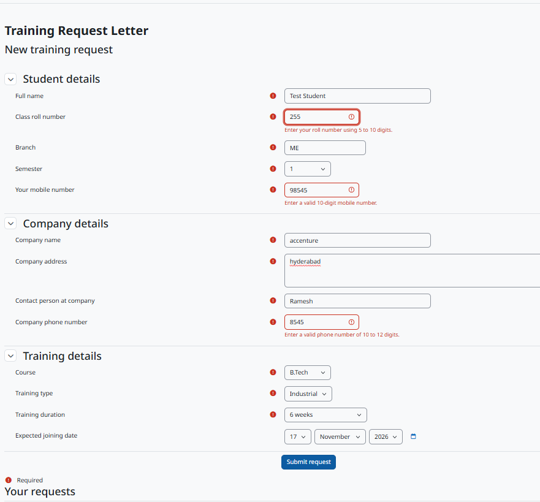
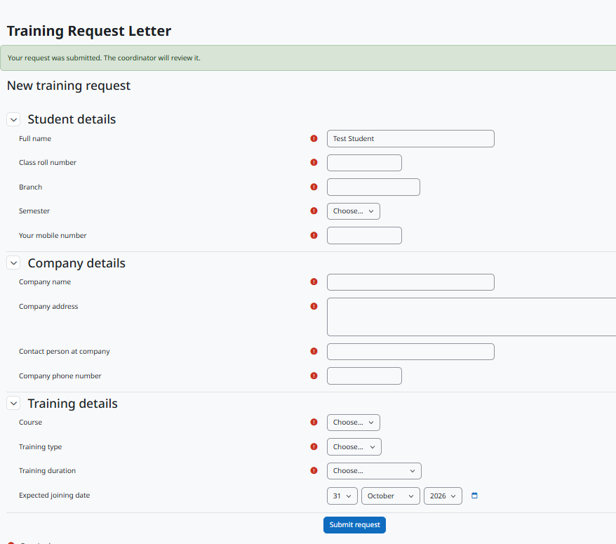
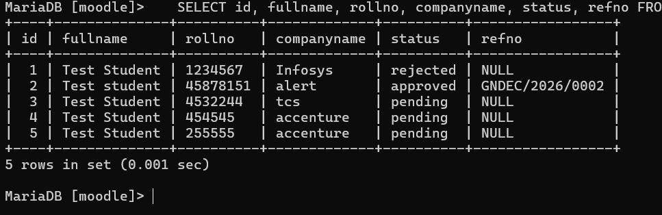
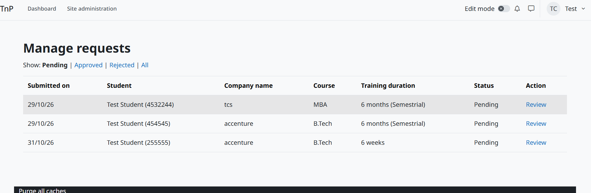
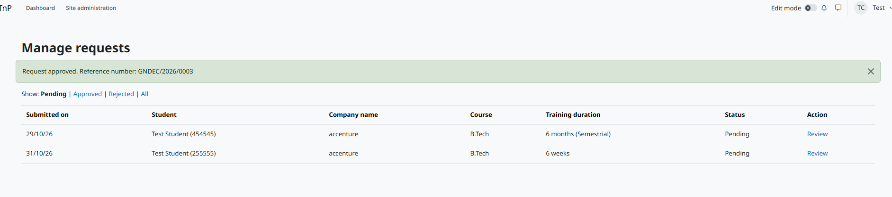
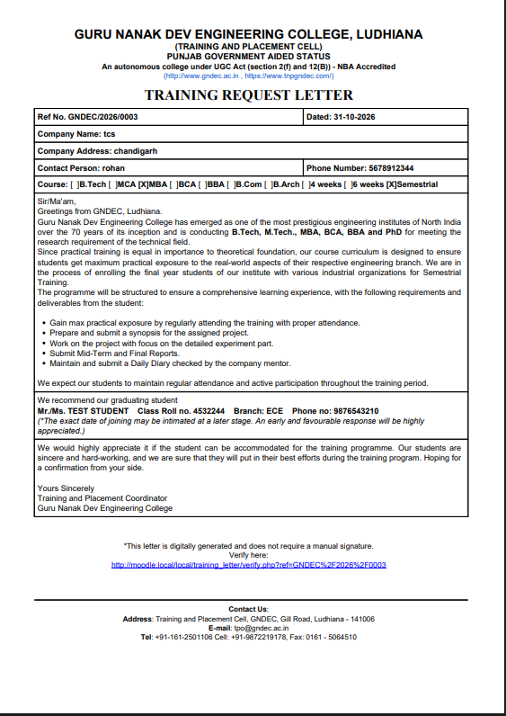
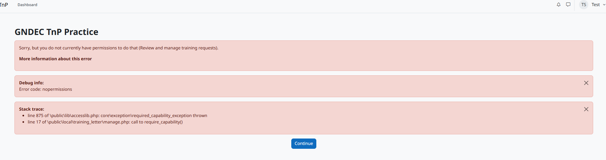

# Training Request Letter Generator (local_training_letter)

Moodle local plugin for the GNDEC Training & Placement Cell. Students submit training details, a coordinator approves or rejects them, and an official Training Request Letter PDF is released only after approval.

## Requirements
Tested on Moodle 5.3, PHP 8.3, MariaDB.

## Installation
1. Copy the `training_letter` folder into:
   - Moodle 5.1 and later: `<moodle>/public/local/`
   - Moodle 5.0 and earlier: `<moodle>/local/`
2. Log in as admin and click **Upgrade Moodle database now**. This creates the table and permissions.
3. Purge caches: Site administration > Development > Purge caches.
4. Make a coordinator: Site administration > Users > Permissions > Assign system roles > Manager.

## How it works
1. Student opens `/local/training_letter/index.php`, fills the form. Status is **Pending**.
2. Coordinator opens `/local/training_letter/manage.php`, reviews the request, adds optional remarks, clicks **Approve** or **Reject**.
3. Approval creates a reference number like `GNDEC/2026/0001`.
4. Approved requests show **Preview** and **Download**. Pending and rejected ones do not.
5. The verify link printed on the letter opens `/local/training_letter/verify.php`.

## Screenshots
**1. Request form**

**2. Request saved (Pending)**

**3. Database table `mdl_local_training_letter`**

**4. Coordinator list**

**5. Approval**

**6. Generated letter**

**7. Access control (student blocked from coordinator page)**

Sample PDF: [sample/sample_training_letter.pdf](sample/sample_training_letter.pdf)

## Notes
- Form follows both the assignment brief and the real GNDEC letter. Joining date is stored but not printed, as in the real letter.
- Letter wording is in `lang/en/local_training_letter.php`.
- Verify page is public and shows a masked name only.
- Names must use English letters.

Author: Gagandeep Singh, Guru Nanak Dev Engineering College.